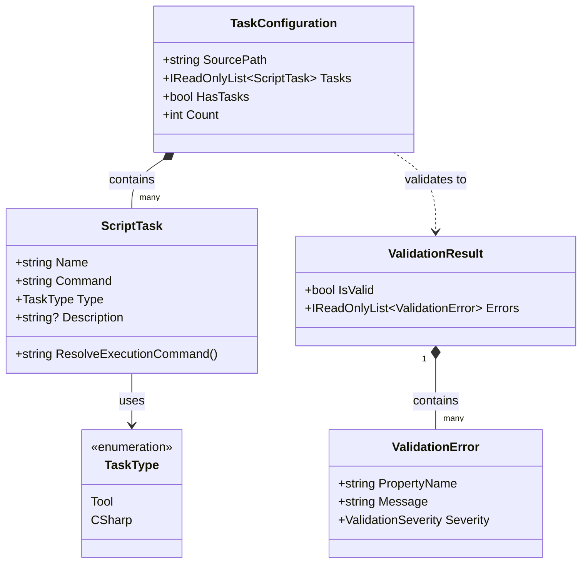

# Data Model: Processador de Configuração JSON

**Feature**: `001-json-config-processor`  
**Date**: 2026-10-30  
**Status**: Ready  

Este documento descreve os modelos de dados, tipos, regras de validação e relacionamentos do processador de configuração do `NetTaskList` (`nxtl`).

---

## 1. Diagrama de Entidades



---

## 2. Descrição das Entidades

### 2.1 `ScriptTask`
Representa um comando ou script configurado individualmente no arquivo JSON.

| Propriedade | Tipo | Obrigatório | Descrição / Regras |
|-------------|------|-------------|--------------------|
| `Name` | `string` | Sim | Identificador amigável da tarefa. Não pode ser nulo, vazio ou conter apenas espaços em branco. Deve ser único dentro da configuração (case-insensitive). |
| `Command` | `string` | Sim | Linha de comando ou instrução a ser executada. Não pode ser nulo ou vazio. |
| `Type` | `TaskType` | Não (Padrão: `TaskType.Tool`) | Categoria da execução. Aceita `tool` (padrão) ou `csharp`. |
| `Description` | `string?` | Não | Texto descritivo opcional exibido na tabela do terminal. |

#### Comportamento `ResolveExecutionCommand()`:
- Se `Type == TaskType.CSharp`:
  - Se `Command` termina com `.cs` e não contém o prefixo `dotnet run`: retorna `dotnet run {Command}`.
  - Caso contrário (já contém argumentos ou a instrução completa): retorna `Command` como está.
- Se `Type == TaskType.Tool`:
  - Retorna `Command` inalterado.

---

### 2.2 `TaskType` (Enum)
Diferencia a categoria de execução de uma tarefa.

| Valor Enum | Valor JSON | Descrição |
|------------|------------|-----------|
| `Tool` | `"tool"` | Comandos CLI gerais e utilitários de shell (ex: `dotnet build`, `npm test`, `docker compose up`). |
| `CSharp` | `"csharp"` | Scripts C# executáveis em modo file-scoped / programa de arquivo único (ex: `script.cs`). |

---

### 2.3 `TaskConfiguration`
Representa o documento de configuração consolidado e carregado em memória.

| Propriedade | Tipo | Descrição |
|-------------|------|-----------|
| `SourcePath` | `string` | Caminho absoluto do arquivo JSON de origem. |
| `Tasks` | `IReadOnlyList<ScriptTask>` | Lista imutável das tarefas validadas e prontas para exibição/execução. |
| `HasTasks` | `bool` | Atalho booleano (`Tasks.Count > 0`). |
| `Count` | `int` | Quantidade total de tarefas cadastradas. |

---

### 2.4 `ValidationResult` e `ValidationError`
Estrutura para transportar diagnósticos semânticos e estruturais na leitura da configuração.

| Propriedade | Tipo | Descrição |
|-------------|------|-----------|
| `IsValid` | `bool` | `true` se nenhuma regra de validação falhou; caso contrário, `false`. |
| `Errors` | `IReadOnlyList<ValidationError>` | Coleção de mensagens diagnósticas detalhadas em português (`pt-BR`). |

---

## 3. Regras de Validação do Modelo

1. **Unicidade de Nome (VR-001)**:
   - Dois scripts não podem possuir o mesmo valor de `Name`.
   - A comparação é estritamente **sem distinção de maiúsculas e minúsculas** (`StringComparer.OrdinalIgnoreCase`).
   - *Violação*: "O script com o nome '{0}' está duplicado no arquivo de configuração. Cada script deve possuir um nome único."

2. **Obrigatoriedade de Nome (VR-002)**:
   - O campo `Name` não pode ser nulo, vazio ou conter apenas caracteres de espaço.
   - *Violação*: "Foi encontrada uma tarefa sem nome válido no arquivo de configuração."

3. **Obrigatoriedade de Comando (VR-003)**:
   - O campo `Command` não pode ser nulo ou vazio.
   - *Violação*: "A tarefa '{0}' não define um comando a ser executado."

4. **Validação de Tipo (VR-004)**:
   - Se fornecido, o campo `Type` deve ser `"tool"` ou `"csharp"` (case-insensitive).
   - Se omitido, assume o valor padrão `"tool"`.
   - *Violação*: "A tarefa '{0}' possui o tipo '{1}' não reconhecido. Os tipos aceitos são 'tool' e 'csharp'."

5. **Integridade da Estrutura JSON (VR-005)**:
   - O arquivo JSON deve ser sintaticamente válido.
   - O documento deve ser um objeto com uma propriedade de lista (`scripts` ou `tasks`) OU um array JSON de objetos na raiz.
   - *Violação*: "O arquivo de configuração '{0}' não é um JSON válido: {1}."

---

## 4. Estrutura do DTO de Deserialização JSON

Para acomodar os dois formatos JSON aceitos (`{ "scripts": [...] }` ou `[...]`), o deserializador interno suporta:

```csharp
internal sealed class ConfigurationDto
{
    [JsonPropertyName("$schema")]
    public string? Schema { get; set; }

    [JsonPropertyName("scripts")]
    public List<ScriptTaskDto>? Scripts { get; set; }

    [JsonPropertyName("tasks")]
    public List<ScriptTaskDto>? Tasks { get; set; }
}

internal sealed class ScriptTaskDto
{
    [JsonPropertyName("name")]
    public string? Name { get; set; }

    [JsonPropertyName("command")]
    public string? Command { get; set; }

    [JsonPropertyName("type")]
    public string? Type { get; set; }

    [JsonPropertyName("description")]
    public string? Description { get; set; }
}

/// <summary>
/// Contexto de Source Generation para System.Text.Json garantindo 100% de compatibilidade com Native AOT e zero reflexão.
/// </summary>
[JsonSourceGenerationOptions(
    WriteIndented = true,
    PropertyNameCaseInsensitive = true,
    DefaultIgnoreCondition = JsonIgnoreCondition.WhenWritingNull)]
[JsonSerializable(typeof(ConfigurationDto))]
[JsonSerializable(typeof(List<ScriptTaskDto>))]
[JsonSerializable(typeof(ScriptTaskDto))]
internal sealed partial class TaskJsonContext : JsonSerializerContext
{
}
```
