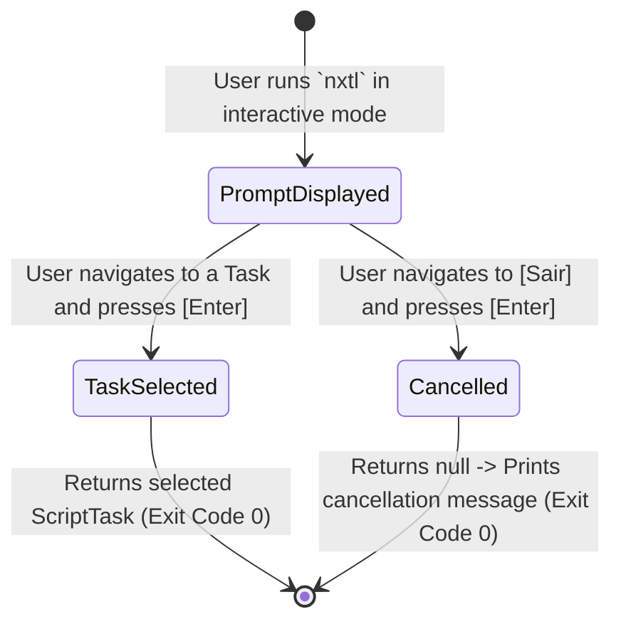

# Data Model: Resilient Interactive Task Selection

**Feature**: `002-fix-selector-markup` | **Phase**: 1 | **Date**: 2026-11-01

## Entities & Records

### 1. `TaskChoice` (Internal Record)

Encapsulates an option presented inside `Spectre.Console.SelectionPrompt<TaskChoice>`.

- **Namespace**: `NetTaskList.Presentation` (private sealed record inside `InteractiveTaskSelector`)
- **Fields**:
  - `Task`: `ScriptTask?`
    - `ScriptTask` instance representing a runnable task, OR `null` representing the exit/cancel action.
  - `DisplayName`: `string`
    - The safe, escaped markup string displayed to the user in the interactive terminal list.

#### Invariants & Validation:
- For task choices: `Task` MUST NOT be null; `DisplayName` MUST be constructed by applying `Markup.Escape` to the compound label string (`$"{task.Name} [{typeTag}] - {description}"`).
- For the exit choice: `Task` MUST be null; `DisplayName` MUST be escaped (`Markup.Escape("[Sair]")` or `"[grey][[Sair]][/]"`).

---

### 2. `ScriptTask` (Domain Entity Reference)

Existing domain model representing a configured task.

- **Namespace**: `NetTaskList.Domain.Models`
- **Fields**:
  - `Name`: `string` (unique task identifier, case-insensitive)
  - `Type`: `TaskType` (`Tool` or `CSharp`)
  - `Command`: `string` (underlying command or script path)
  - `Description`: `string?` (optional human-readable explanation)

---

## State Transitions & Selection Flow

