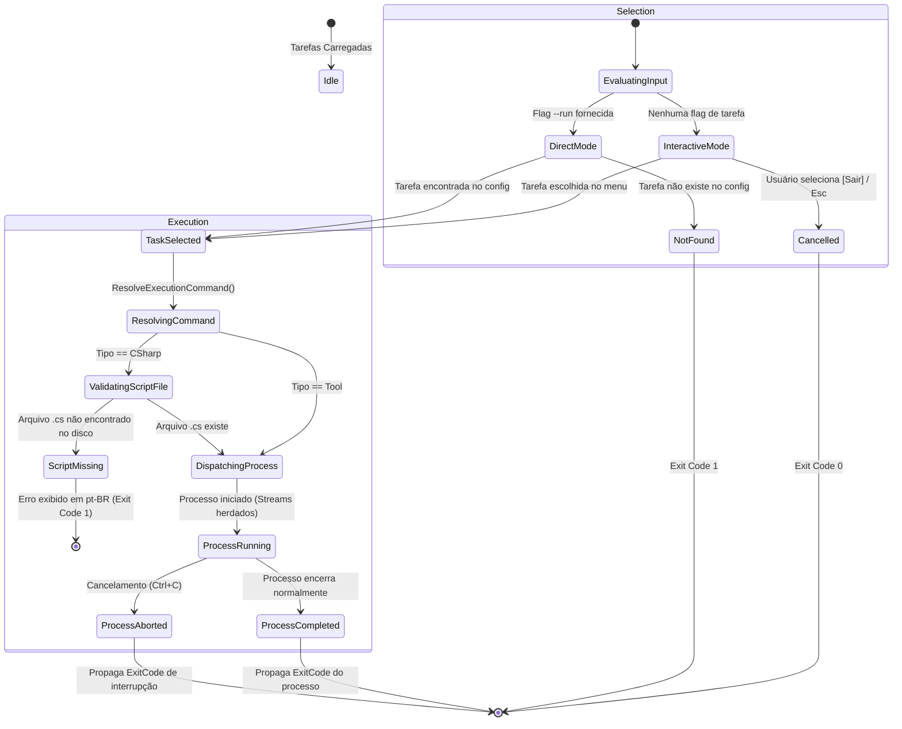

# Data Model: Mecanismo de Execução de Tarefas e Scripts Configurados

**Feature**: `003-execute-configured-tasks` | **Date**: 2026-11-01

Este documento descreve os modelos de dados, estruturas de resultado, ciclo de vida e regras de transição de estado envolvidas na execução de tarefas e scripts configurados no NetTaskList.

---

## 1. Entidades de Dados

### 1.1 `ProcessExecutionResult` (Resultado de Execução)
Representa o resultado da tentativa de execução de um processo no sistema operacional.

- **Namespace**: `NetTaskList.Domain.Models` (ou `NetTaskList.Infrastructure.Abstractions`)
- **Propriedades**:
  - `ExitCode` (`int`): Código numérico de saída retornado pelo processo concluído. Padrão `0` para sucesso. Códigos diferentes de zero indicam encerramento com falha ou erro.
  - `Success` (`bool`): Indicador derivado (`ExitCode == 0 && ErrorMessage == null`).
  - `ErrorMessage` (`string?`): Mensagem de erro em caso de falha antes ou durante a inicialização do processo (ex: arquivo não encontrado, comando não reconhecido pelo shell, permissão negada).
- **Métodos Construtores / Fábrica**:
  - `ProcessExecutionResult.FromExitCode(int exitCode)`: Cria um resultado baseado em um processo que executou e encerrou normalmente com o código fornecido.
  - `ProcessExecutionResult.Failure(string errorMessage, int exitCode = 1)`: Cria um resultado indicando falha na inicialização do processo.

---

### 1.2 `ScriptTask` (Entidade Existente - Modelo de Tarefa)
Representa uma tarefa configurada no arquivo `nxtl.json`.

- **Namespace**: `NetTaskList.Domain.Models`
- **Propriedades**:
  - `Name` (`string`): Identificador único da tarefa.
  - `Command` (`string`): Linha de comando ou caminho do script.
  - `Type` (`TaskType`): Categoria da tarefa (`Tool` ou `CSharp`).
  - `Description` (`string?`): Descrição legível da tarefa.
- **Métodos**:
  - `ResolveExecutionCommand()` (`string`): Resolve a linha de comando efetiva:
    - Se `Type == TaskType.CSharp` e `Command` termina com `.cs` e não inicia com `dotnet run`, infere `dotnet run {Command}`.
    - Se `Type == TaskType.Tool` ou já inicia com `dotnet run`, retorna o comando inalterado.

---

### 1.3 `TaskType` (Enum de Categoria)
- `Tool`: Comando genérico de terminal/shell.
- `CSharp`: Script C# executável em modo file-scoped via .NET.

---

## 2. Diagrama de Transição de Estados da Execução

---

## 3. Regras de Negócio e Validação de Dados

1. **Unicidade de Tarefa**: A tarefa selecionada deve existir na lista configurada (busca insensível a maiúsculas/minúsculas).
2. **Existência do Arquivo C#**: Para tarefas do tipo `CSharp`, se o comando original referenciar um caminho de arquivo `.cs` simples, a existência do arquivo é verificada antes do despacho; se ausente, aborta com erro amigável em `pt-BR`.
3. **Propagação Fiel de Código**: O código numérico de saída do processo filho torna-se diretamente o código de saída do executável `nxtl`.
4. **Isolamento de Erros de Inicialização**: Erros do sistema operacional (como `Win32Exception` ou falta de interpretador) são encapsulados em mensagens claras em português e geram código de saída `1` ou `2`.
