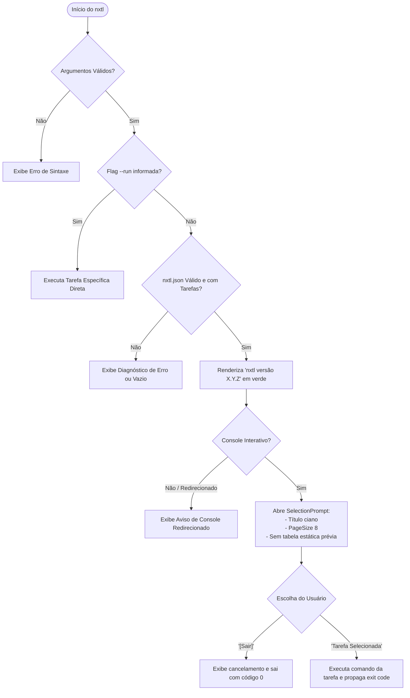

# Data Model & Presentation Architecture: Melhoria do Output de Execução e Navegação de Tarefas

**Feature**: `004-improve-execution-output` | **Date**: 2026-11-01

Este documento descreve as entidades de apresentação, estruturas conceituais e ciclo de renderização no terminal para a melhoria de saída do `nxtl`.

---

## 1. Entidades de Apresentação

### 1.1 `AppVersion` (Componente de Resolução de Versão)

Representa a versão da aplicação inferida a partir dos metadados do assembly do binário.

- **Campos**:
  - `Current` (`string`): Versão semântica limpa no formato `Major.Minor.Patch` (ex: `"1.0.0"`).
- **Regras de Validação & Transformação**:
  - Se metadados de commit (`+<hash>`) estiverem presentes em `AssemblyInformationalVersionAttribute`, descartar o sufixo de build.
  - Se nenhum atributo informacional estiver disponível, utilizar `Assembly.GetName().Version` formatando os 3 primeiros segmentos (`Major.Minor.Build`).
  - Caso a versão não possa ser determinada em tempo de execução, retornar o padrão de segurança `"1.0.0"`.

### 1.2 `ListingHeader` (Cabeçalho da Listagem)

Estrutura visual renderizada no topo da interação do terminal antes da seleção de tarefas.

- **Atributos de Renderização**:
  - **Texto Base**: `"nxtl versão {AppVersion.Current}"`
  - **Estilização ANSI**: Verde (`[green]`)
  - **Posicionamento**: Primeira linha emitida após validação da configuração no fluxo padrão.

### 1.3 `TaskSelectionPrompt` (Configuração do Viewport Interativo)

Parâmetros de configuração aplicados ao `SelectionPrompt<TaskChoice>` do Spectre.Console.

- **Propriedades**:
  - `Title`: `"[cyan]Selecionar uma tarefa para executar[/]"` (cor ciano, sem dois pontos finais).
  - `PageSize`: `8` (limite estrito de tarefas simultâneas visíveis na janela de rolagem).
  - `MoreChoicesText`: `"[grey](Mova para cima e para baixo para ver mais opções)[/]"` (instrução amigável em pt-BR quando a lista exceder 8 itens).
  - `Choices`: Lista de escolhas contendo as tarefas configuradas (`ScriptTask`) mapeadas para `TaskChoice` mais a escolha neutra `[Sair]`.

---

## 2. Diagrama de Fluxo de Execução da Saída do Terminal

---

## 3. Comparativo de Apresentação (Antes vs Depois)

| Elemento | Comportamento Anterior | Novo Comportamento Proposto |
|---|---|---|
| **Tabela Estática** | Exibia tabela completa com bordas e título `"Tarefas Disponíveis (nxtl)"` | **Completamente removida** no fluxo interativo |
| **Cabeçalho de Versão** | Inexistente na listagem padrão (apenas via `nxtl -v`) | **Exibido no topo**: `"nxtl versão <código da versão atual>"` em verde |
| **Título do Seletor** | `[bold yellow]Selecione uma tarefa para executar:[/]` | `[cyan]Selecionar uma tarefa para executar[/]` |
| **Itens Visíveis (PageSize)** | 15 tarefas visíveis por vez | **8 tarefas visíveis por vez** com rolagem ativa |
