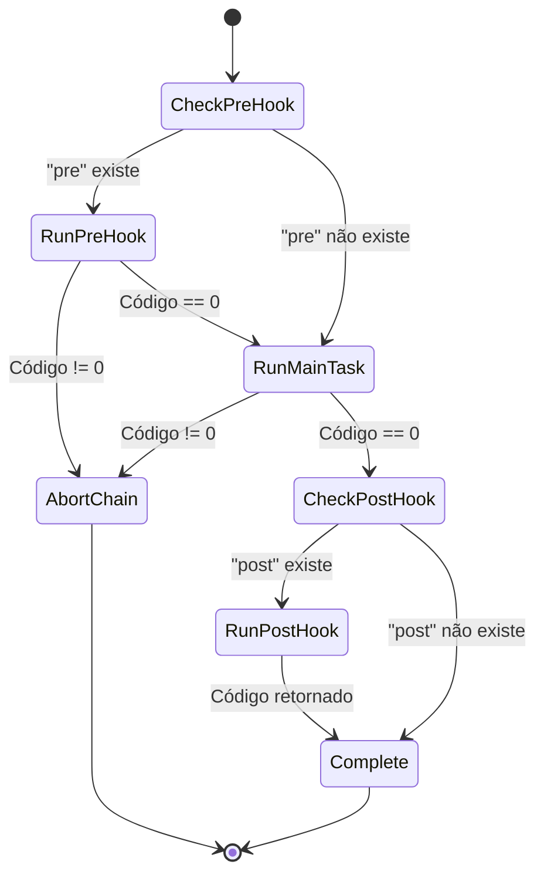

# Data Model: Suporte ao Arquivo package.json (package.json Support)

## Overview
Este documento descreve os modelos de dados, estruturas de transferência (DTOs), entidades de domínio e regras de validação utilizadas para suportar a leitura e execução de scripts de arquivos `package.json`.

---

## Entities & Value Objects

### 1. `ConfigurationSourceType` (Enum)
Identifica a origem do arquivo de configuração resolvido pelo sistema:
- `NxtlJson`: Arquivo nativo do `nxtl` (`nxtl.json`).
- `PackageJson`: Arquivo de pacote do ecossistema Node/JavaScript (`package.json`).
- `Custom`: Arquivo informado explicitamente pelo usuário via `--config <caminho>` cuja nomenclatura não seja padrão.

### 2. `TaskConfiguration` (Domain Model - Atualização)
Representa o documento de configuração consolidado em memória.
- **Campos**:
  - `SourcePath` (`string`): Caminho absoluto para o arquivo de configuração carregado.
  - `SourceType` (`ConfigurationSourceType`): Origem da configuração (`NxtlJson`, `PackageJson` ou `Custom`).
  - `Tasks` (`IReadOnlyList<ScriptTask>`): Lista de tarefas consolidadas e validadas.
  - `HasTasks` (`bool`): Indicador booleano se há tarefas configuradas.
  - `Count` (`int`): Quantidade total de tarefas.
- **Regras de Negócio**:
  - Imutável após instanciação.
  - Lista de tarefas não nula (vazia caso o arquivo não contenha scripts).

### 3. `ScriptTask` (Domain Model - Existente)
Representa uma tarefa executável.
- **Campos**:
  - `Name` (`string`): Identificador único da tarefa (ex: `"build"`, `"pretest"`, `"start"`).
  - `Command` (`string`): Linha de comando a ser executada no shell (ex: `"dotnet build"`, `"node index.js"`).
  - `Type` (`TaskType`): Tipo de execução (`Tool` ou `CSharp`). Tarefas importadas do `package.json` recebem `TaskType.Tool`.
  - `Description` (`string?`): Descrição legível da tarefa (opcional; `null` para tarefas originadas de `package.json`).

### 4. `PackageJsonDto` (Infrastructure DTO)
Estrutura utilizada pela desserialização do `System.Text.Json` para extrair metadados e scripts de `package.json`.
- **Campos**:
  - `Name` (`string?`): Nome do pacote (metadado opcional).
  - `Scripts` (`Dictionary<string, JsonElement>?` ou `Dictionary<string, string>?`): Dicionário de scripts declarados.

---

## Validation Rules

1. **Validação de Sintaxe JSON**:
   - O arquivo `package.json` deve ser um JSON válido com chave-raiz em formato de objeto.
   - Em caso de JSON malformado, o leitor lança `JsonConfigurationException` com mensagem explicativa em português (`pt-BR`).

2. **Validação de Scripts**:
   - Cada chave dentro de `"scripts"` deve ser uma cadeia de caracteres não nula e não vazia.
   - O valor correspondente deve ser uma cadeia de caracteres (string). Valores numéricos, booleanos, nulos ou objetos são rejeitados com erro de validação.
   - Comandos vazios ou compostos exclusivamente por espaços em branco são rejeitados.

3. **Ausência da Seção Scripts**:
   - Se o `package.json` não possuir o campo `"scripts"` ou se o objeto for vazio, o leitor retorna uma `TaskConfiguration` com lista vazia de tarefas sem lançar exceção.

---

## Lifecycle State & Execution Transitions

Para tarefas de um `package.json`:

