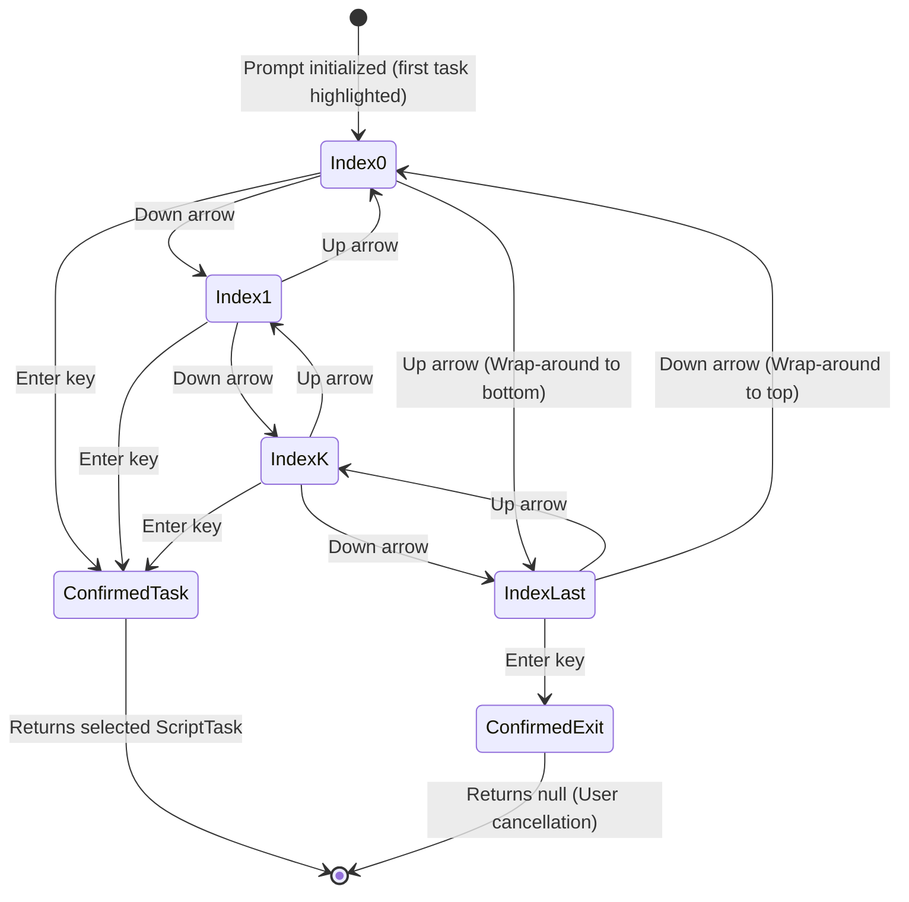

# Data Model: Vertical Carousel Terminal Selection

**Feature**: `008-vertical-carousel-selection` | **Phase**: 1 | **Date**: 2026-11-03

## Entities & Records

### 1. `TaskChoice` (Internal Presentation Record)

Encapsulates an option presented inside `Spectre.Console.SelectionPrompt<TaskChoice>`.

- **Namespace**: `NetTaskList.Presentation` (private sealed record inside `InteractiveTaskSelector`)
- **Fields**:
  - `Task`: `ScriptTask?`
    - A `ScriptTask` instance representing a configured runnable task, OR `null` representing the exit/cancel action (`[Sair]`).
  - `DisplayName`: `string`
    - The escaped markup string displayed to the user in the interactive terminal list.

#### Invariants & Validation:
- The choice list contains $N$ total items ($M$ configured display tasks + 1 exit item, where $N = M + 1$).
- Choice indices range from $0$ to $N - 1$.
- Index $0$: First configured task (default selected item on prompt initialization).
- Index $N - 1$: The exit option (`[Sair]`).

---

### 2. `NavigationCursor` (State Representation)

Represents the active selection pointer during user interaction in the terminal prompt.

- **State Attribute**: `CurrentIndex` $\in [0, N - 1]$
- **Initial State**: `CurrentIndex = 0` (first choice highlighted)
- **Input Events**:
  - `ConsoleKey.DownArrow`: Moves cursor to next choice cyclically.
  - `ConsoleKey.UpArrow`: Moves cursor to previous choice cyclically.
  - `ConsoleKey.Enter`: Confirms current choice and terminates prompt.

#### Transition Rules (Vertical Carousel):
- **Down Navigation ($T_{\text{down}}$)**:
  $$\text{CurrentIndex}_{\text{next}} = (\text{CurrentIndex} + 1) \pmod N$$
  - When $\text{CurrentIndex} < N - 1$: $\text{CurrentIndex}_{\text{next}} = \text{CurrentIndex} + 1$
  - When $\text{CurrentIndex} == N - 1$: $\text{CurrentIndex}_{\text{next}} = 0$ (wraps around to the first item)
- **Up Navigation ($T_{\text{up}}$)**:
  $$\text{CurrentIndex}_{\text{next}} = (\text{CurrentIndex} - 1 + N) \pmod N$$
  - When $\text{CurrentIndex} > 0$: $\text{CurrentIndex}_{\text{next}} = \text{CurrentIndex} - 1$
  - When $\text{CurrentIndex} == 0$: $\text{CurrentIndex}_{\text{next}} = N - 1$ (wraps around to the last item, which is `[Sair]`)

---

## State Diagram: Carousel Navigation Loop

